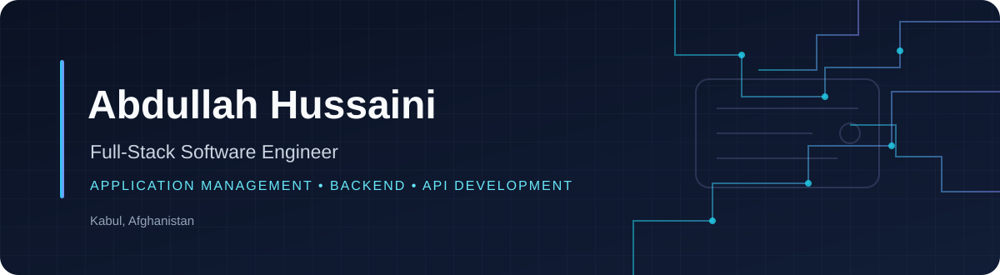

<!--
  GitHub Profile README for Abdullah Hussaini
  Before publishing:
  1. Replace YOUR_GITHUB_USERNAME everywhere below.
  2. Replace the LinkedIn URL with your real profile, or remove that badge.
  3. Add links to public repositories in the Featured Projects section.
-->

  

  <h3>Full-Stack Software Engineer | Application Management | Backend & API Development</h3>

  

    Building reliable web and mobile applications, enterprise integrations, and scalable digital solutions.
  

  

    
    
    
  

---

## 👋 About Me

I'm **Abdullah Hussaini**, a software engineer and application management professional based in Kabul, Afghanistan, with **7+ years of experience** developing and supporting web and mobile applications.

My work spans full-stack development, backend architecture, database design, API integrations, application lifecycle management, testing, and deployment. I enjoy translating business requirements into secure, maintainable software and collaborating with teams to deliver dependable solutions.

- 💼 Currently: **Application Management Manager**
- 🏢 Experience: enterprise banking, logistics, healthcare, and business applications
- 🔧 Focus: Laravel, PHP, React, Next.js, API integrations, and relational databases
- 📱 Mobile: Android development and Oracle Banking Digital app workflows
- 🌍 Location: Kabul, Afghanistan
- ✉️ Email: [h.abdullah1394@gmail.com](mailto:h.abdullah1394@gmail.com)

## 🧰 Technology Stack

### Frontend

  

### Backend

  

### Mobile

  

### Databases & Tools

  

**Additional experience:** REST APIs, SOAP web services, AJAX, unit and integration testing, Xcode, Android build/release workflows, App Store and Google Play deployment.

> The icons are a visual summary of technologies listed in my CV. They do not imply equal depth of experience in every tool.

## 💼 Professional Experience

### Application Management Manager
**The First MicroFinance Bank – Afghanistan (FMFB-A)** · Dec 2024 – Present

- Lead and coordinate application management and continuous improvement activities.
- Oversee internal web applications built with Laravel, Next.js, Tailwind CSS, and MySQL.
- Guide application design patterns, code structure, testing, and quality standards for Oracle Banking Digital applications on iOS and Android.
- Oversee REST API integrations, database reporting, troubleshooting, and performance improvements.
- Coordinate mobile application builds, releases, and deployment activities.

### Senior Application Management Officer
**The First MicroFinance Bank – Afghanistan (FMFB-A)** · Oct 2022 – Dec 2024

- Developed internal applications including inventory management, rate collection, loan write-off, circular/letter management, and policy portal systems.
- Worked on the bank website and Oracle Banking Digital integrations.
- Implemented REST and SOAP services, SQL queries, unit testing, and integration testing.
- Supported iOS and Android application builds, debugging, and releases.

### Full-Stack Web Developer
**Peace Global Logistic** · Oct 2021 – Sep 2022

- Designed and implemented a web-based accounting application using Laravel and MySQL.
- Developed auction software using Next.js, Tailwind CSS, and Laravel.

### Software Developer
**Asr-e Fartak** · Mar 2021 – Aug 2021

- Developed Android applications and a React-based administration panel.
- Designed and worked with MySQL, SQLite, and Firebase databases.

### Software Developer
**GlideSoft** · Mar 2018 – Feb 2021

- Developed mobile and web applications using Laravel, Blade, MySQL, JavaScript, HTML5, CSS3, Bootstrap, and jQuery.
- Contributed to database design and analysis.

## 🚀 Selected Project Experience

The following projects are described in my CV. Public repository or live-demo links can be added when available.

- **Banking & internal enterprise applications** — inventory management, rate collection, loan write-off, policy portal, and circular/letter management.
- **Accounting application** — web-based accounting system developed with Laravel and MySQL.
- **Auction platform** — application built with Next.js, Tailwind CSS, and Laravel.
- **Healthcare systems** — hospital and pharmacy management applications.
- **Restaurant management systems** — web and Android solutions.
- **Business websites** — including [Pamir Tiling Services](https://pamirtilingservices.com.au/) and [Hafiz Group of Companies](https://hgc.af/).

## 📊 GitHub Overview

<!-- Replace YOUR_GITHUB_USERNAME in each URL with your exact GitHub username. -->

  
  

  

  

## 🎓 Education

**Bachelor of Computer Science** — Kateb University · 2015–2019

## 🌐 Languages

- Dari — Native
- English — C1 (TOEFL score: 95, as stated in my CV)
- Pashto — Fluent

---

  **Let's connect and build useful software.**

  

  Designed and maintained by Abdullah Hussaini.

